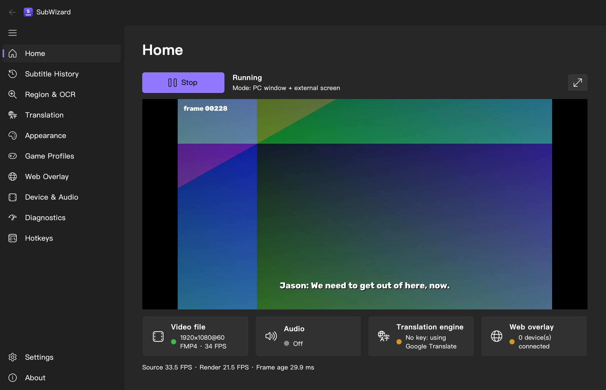
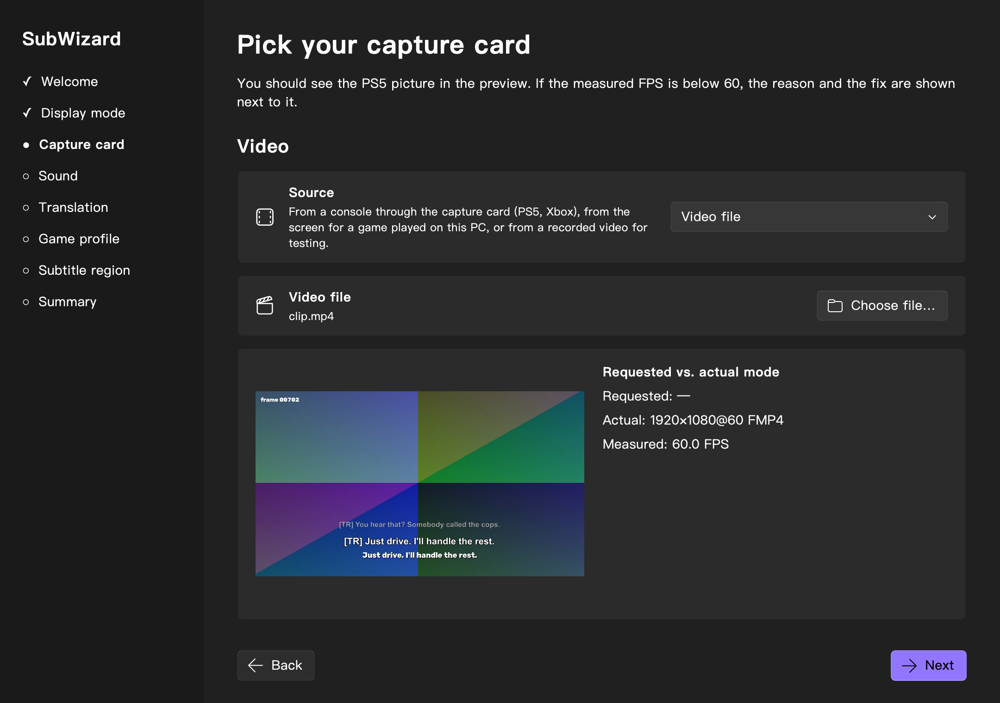
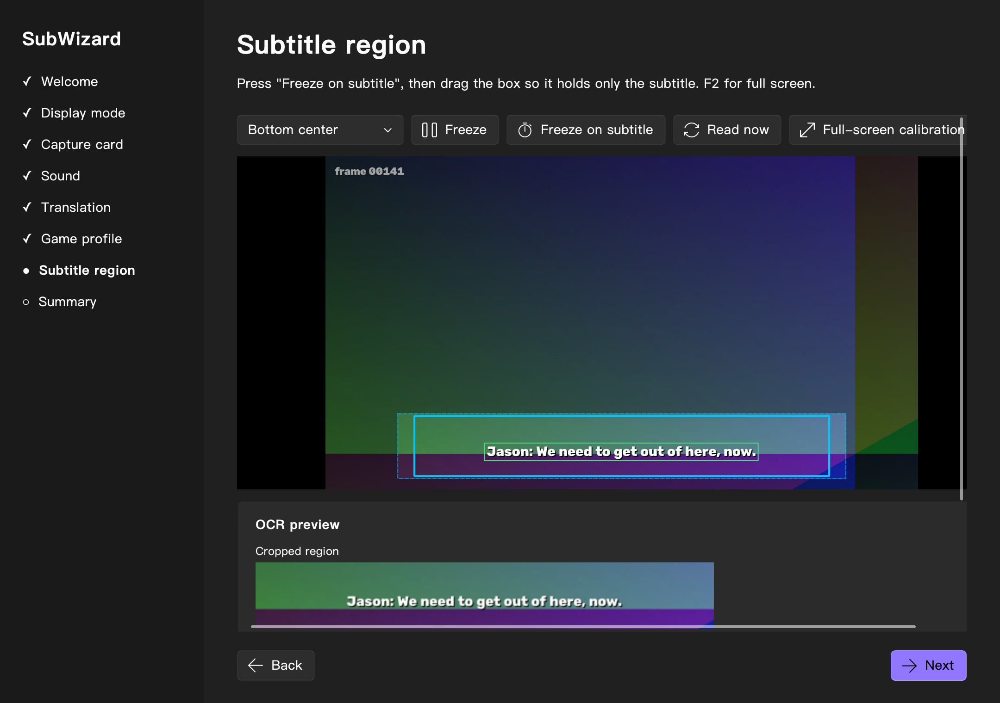
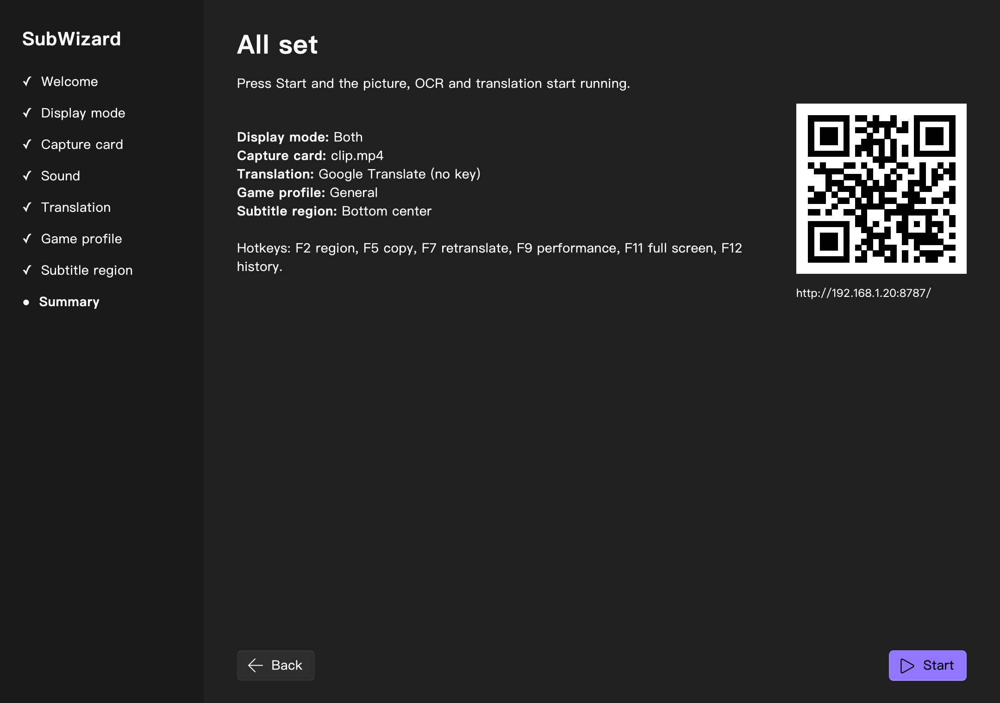

# SubWizard

**English** · [Türkçe](README.tr.md)

An open-source tool that reads the English subtitles in game footage coming from a PS5 through
a capture card (OCR), translates them into natural Turkish and shows them on screen — or on a
web page on your phone. Target platform: Windows 10/11.



> In development (version 0.1). There is no installer yet; for now
> [run from source](#run-from-source). Roadmap: [SPEC.md](SPEC.md) (Turkish).

## How it works

```
PS5 ──HDMI──▶ capture card ──USB──▶ PC:  video → OCR (subtitle region) → translation → overlay
```

There are two ways to use it; the setup wizard asks on first launch.

| | Mode A — play on the PC | Mode B — play on the TV |
|---|---|---|
| Wiring | PS5 → capture card → PC | PS5 → capture card → **loop-out → TV**; the PC only reads |
| Where the game is | On the PC (SubWizard window, F11 full screen) | On the TV, no added latency, original quality |
| Where the translation is | Over the video | A web page on a phone / tablet / second screen (opened by QR), or OBS |
| Audio | From the PC (capture card audio input) | From the TV; mute the PC (F6) |

"Both" shows the translation over the video and also streams it to the web page (for OBS).

**PC game (no capture card needed):** If the game runs on this PC, set Device & Audio → Source:
**Screen (PC game)** (the "PC game" card in the wizard). The screen is read and the Turkish subtitle
appears on a transparent layer over the game; clicks go through to the game. Run the game in
**Borderless window** mode: in exclusive fullscreen no window can appear over it. In that case show
the translation on the web page (phone / second screen).

## First launch

The setup wizard configures everything in 8 steps: language, mode, capture card (live preview
and measured FPS), audio, translation engine (Gemini key or keyless), game profile, subtitle
region and summary. Reopen it later from **Settings → Open wizard**.

| Capture card | Subtitle region | Summary (Mode B: QR) |
|---|---|---|
|  |  |  |

The interface is available in Turkish and English (Settings → Language).

### Translation engine

- **Gemini (recommended):** get a free key at
  [aistudio.google.com/apikey](https://aistudio.google.com/apikey), paste it on the Translation
  page, **Add**, **Test**. The key is stored in Windows Credential Manager, never in the
  settings file or the logs. Enter several keys separated by commas to switch to the next one
  when a quota runs out.
- **Keyless:** uses Google Translate; free but lower quality. Shown with a "(fallback)" mark.
  SubWizard also falls back to it automatically when Gemini does not respond.

Translations are cached, so the same line is never translated twice; the cost is shown on the
Translation page.

### Game profiles

The Game Profiles page keeps per-game info, a glossary (e.g. "Vice City" → keep as is) and lines
to ignore; they are added to the translation prompt. Built in: GTA 6. Profiles export / import as
.yaml. On the Region & OCR page you can draw extra subtitle regions and excluded areas.

### Experimental

- **Vision mode** (Translation → Reading method): the region image goes straight to Gemini, which
  reads and translates in one request. Needs a key.
- **Windows OCR** (Region & OCR → OCR engine): Windows' own OCR, no model download.
- **Read aloud** (Translation → Read aloud): speaks the translation or the English line. System voice (Windows SAPI) or Edge (online, natural Turkish voice).

## Hotkeys

Change them on the Hotkeys page. On Windows they also work while the game window is in front.

| Key | Action |
|---|---|
| F2 | Calibrate the subtitle region (the frame freezes, draw the box) |
| F5 | Copy the last translation |
| F6 | Mute / unmute |
| F7 | Retranslate the current line (skips the cache) |
| F8 | Pause / resume translation |
| F9 | Performance overlay: off → compact → detailed |
| F10 | Hide / show subtitles |
| F11 | Full screen |
| F12 | History panel of recent lines (for subtitles you missed) |

## Web overlay (Mode B, OBS)

On the Web Overlay page set the mode to "Play on TV" or "Both" and scan the QR code with your
phone (same Wi-Fi as the PC). The page reconnects by itself if the connection drops. For OBS:
**Copy URL for OBS** → Browser Source (transparent background). Page settings can also be set in
the URL: `?font=64&lines=2&source=1`. Optionally set an access token; the QR code includes it.

Without the interface (web overlay only): `uv run run.py --headless`.

## Troubleshooting

| Symptom | Fix |
|---|---|
| "Capture card not found" | Is it on a USB 3.0 port? Is another program (e.g. OBS) using the device? Device & Audio → refresh. |
| Measured FPS below 60 | The Device & Audio page says why (USB 2.0, pixel format, resolution). Pick the 1080p60 mode. |
| Subtitles are not read | Use F2 to shrink the region to just the subtitles; try Region & OCR → "Freeze on subtitle". |
| No translation | The Translation card on Home says why (no key, no internet). Translation → **Test**. |
| The phone can't open the page | Same Wi-Fi? If Windows Firewall asks on first launch, allow "Private networks". |
| Audio is heard twice | In Mode B mute the PC (F6). |
| Sound comes before the picture | Device & Audio → **Measure** (while an A/V sync test video with flashes + beeps plays), or the slider. |
| Anything else | Diagnostics → **Support bundle** creates a .zip; attach it to an issue (it contains no API keys). |

## Run from source

In PowerShell:

```
winget install --id Git.Git -e
winget install --id GitHub.cli -e
winget install --id astral-sh.uv -e
```

Close and reopen PowerShell (the repository is private, so sign in to GitHub first):

```
gh auth login
gh repo clone alptuggurler/subwizard
cd subwizard
uv sync
uv run run.py
```

`uv sync` downloads Python 3.12 and the dependencies itself. To update: `git pull`, then
`uv sync` again. What to test on Windows and how: [docs/WINDOWS_TESTING.md](docs/WINDOWS_TESTING.md)
(Turkish).

## Development

```
uv sync
uv run pytest                                               # tests
uv run python scripts/make_test_clip.py --out clip.mp4      # synthetic test clip with subtitles
uv run run.py --source file --path clip.mp4                 # try it without a capture card
uv run python scripts/screenshot_pages.py --clip clip.mp4 --offline-translation   # screenshots + measurements
uv sync --group build
uv run python scripts/build_windows.py --zip                # Windows package (PyInstaller)
```

Contribution rules and adding a language: [CONTRIBUTING.md](CONTRIBUTING.md) (Turkish).

## Acknowledgements

These projects inspired some of SubWizard's features. Only ideas were taken; no code was copied from any of them.

| Project | License | Ideas |
|---|---|---|
| [sefflex/GameTranslator](https://gitlab.com/sefflex/GameTranslator) | AGPL-3.0 | Translation on a second screen (web/OBS overlay), region templates, replace mode, game slang glossary |
| [thanhkeke97/RSTGameTranslation](https://github.com/thanhkeke97/RSTGameTranslation) | GPL-3.0 | Multiple and excluded regions, ignore list, game profiles with game context, multiple API keys, history |
| [ramjke/Translumo](https://github.com/ramjke/Translumo) | Apache-2.0 | Windows OCR as a fast default, keeping the OCR region small |

## License

GPL-3.0-or-later.
