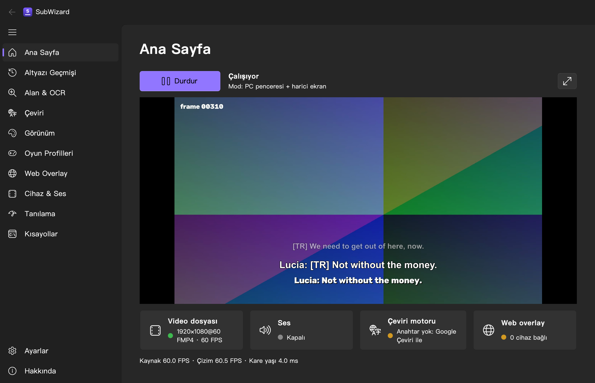
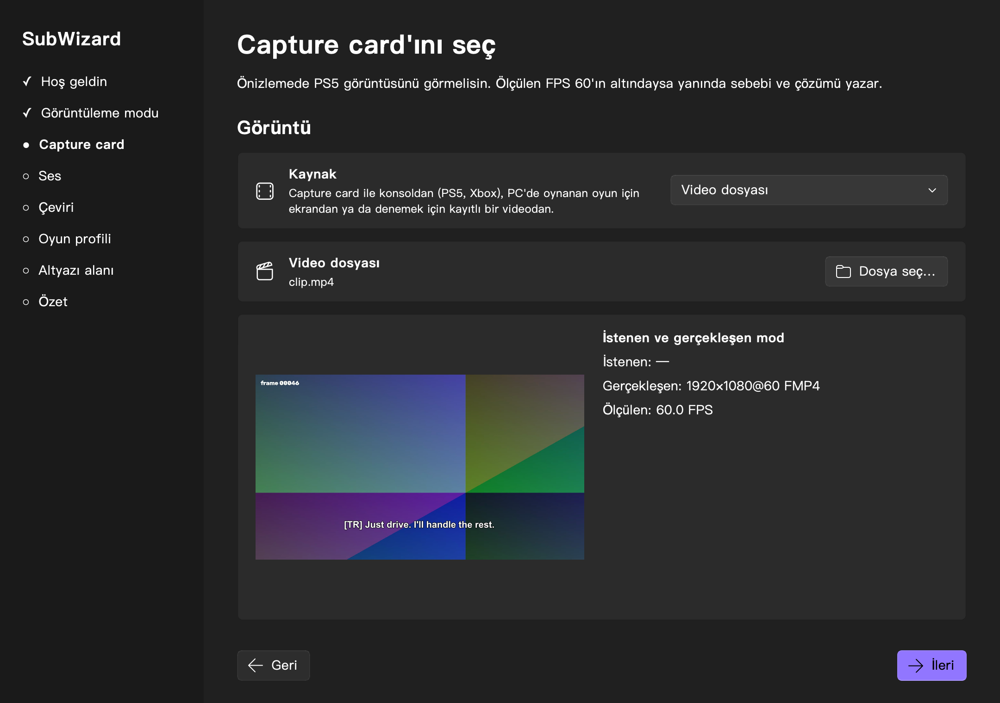
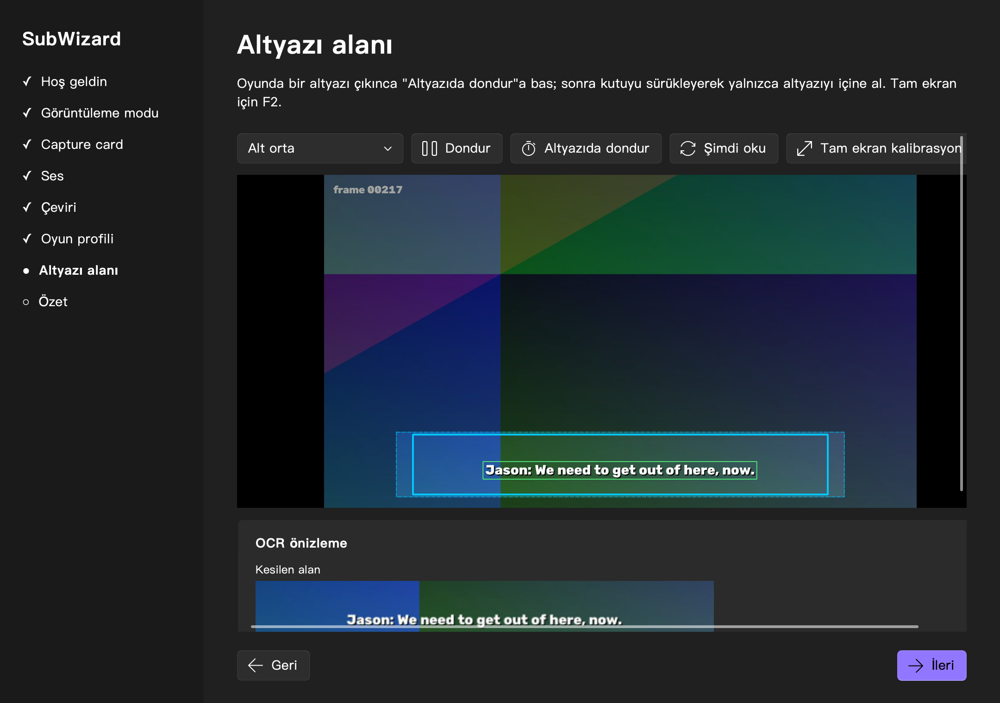
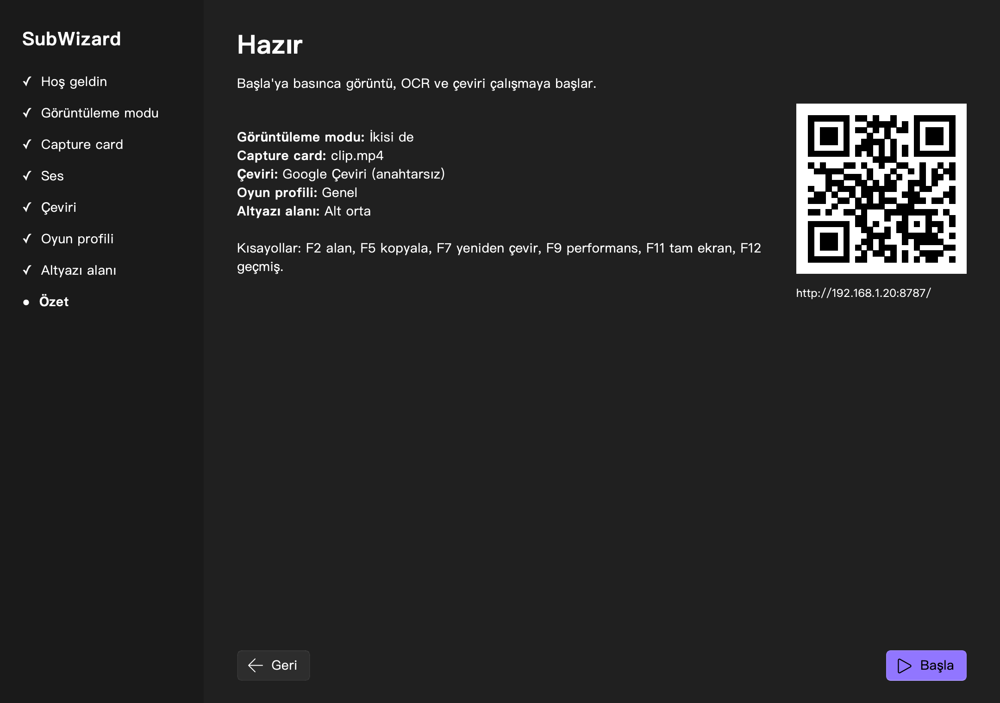

# SubWizard

[English](README.md) · **Türkçe**

PS5'ten capture card ile PC'ye gelen oyun görüntüsündeki İngilizce altyazıları okuyup (OCR)
doğal Türkçeye çeviren ve ekrana — ya da telefondaki bir web sayfasına — basan açık kaynak
araç. Hedef platform: Windows 10/11.



> Geliştirme aşamasında (sürüm 0.1). Kurulum dosyası henüz yayımlanmadı; şimdilik
> [kaynaktan çalıştır](#kaynaktan-çalıştırma). Yol haritası: [SPEC.md](SPEC.md).

## Nasıl çalışır

```
PS5 ──HDMI──▶ capture card ──USB──▶ PC:  görüntü → OCR (altyazı alanı) → çeviri → overlay
```

İki kullanım şekli var; kurulum sihirbazı ilk açılışta sorar.

| | Mod A — PC'de oyna | Mod B — TV'de oyna |
|---|---|---|
| Bağlantı | PS5 → capture card → PC | PS5 → capture card → **loop-out → TV**; PC yalnızca okur |
| Oyun nerede | PC ekranında (SubWizard penceresi, F11 tam ekran) | TV'de, gecikmesiz ve orijinal kalitede |
| Çeviri nerede | Görüntünün üstünde | Telefon / tablet / ikinci ekranda bir web sayfası (QR ile açılır) ya da OBS |
| Ses | PC'den (capture card ses girişi) | TV'den; PC sesini kapat (F6) |

"İkisi de" seçeneği PC'de oynarken çeviriyi aynı anda web sayfasında da yayınlar (OBS için).

**PC oyunu (capture card gerekmez):** Oyun bu PC'de çalışıyorsa Cihaz & Ses → Kaynak: **Ekran (PC oyunu)**
(sihirbazda "PC oyunu" kartı). Ekran okunur, Türkçe altyazı oyunun üstünde şeffaf bir katmanda
görünür; tıklamalar oyuna geçer. Oyunu **Kenarlıksız pencere (Borderless)** modunda aç: tam ekran
(exclusive) modda hiçbir pencere oyunun üstünde görünemez. Bu durumda çeviriyi web sayfasında
(telefon / ikinci ekran) göster.

## İlk açılış

Kurulum sihirbazı 8 adımda her şeyi ayarlar: dil, mod, capture card (canlı önizleme ve
ölçülen FPS), ses, çeviri motoru (Gemini anahtarı ya da anahtarsız), oyun profili, altyazı
alanı ve özet. Sonradan **Ayarlar → Sihirbazı aç** ile yeniden açılır.

| Capture card | Altyazı alanı | Özet (Mod B: QR) |
|---|---|---|
|  |  |  |

### Çeviri motoru

- **Gemini (önerilen):** [aistudio.google.com/apikey](https://aistudio.google.com/apikey)
  adresinden ücretsiz anahtar al, Çeviri sayfasına yapıştır, **Ekle**, **Test et**. Anahtar
  Windows Kimlik Bilgisi Yöneticisi'nde saklanır; ayar dosyasına ve loglara yazılmaz.
  Birden çok anahtar ekleyebilirsin; kota dolunca sıradakine geçer, listede hangisinin dinlendiği görünür.
- **Anahtarsız:** Google Çeviri ile çalışır; ücretsiz ama daha düşük kalite. Ekranda
  "(yedek)" işaretiyle görünür. Gemini yanıt vermezse de otomatik olarak buna düşer.

Çeviriler önbelleğe alınır: aynı satır ikinci kez çevrilmez; maliyet Çeviri sayfasında görünür.

### Oyun profilleri

Oyun Profilleri sayfasında oyuna özel bilgi, sözlük (ör. "Vice City" → çevirme) ve yok sayılacak
satırlar tutulur; çeviri prompt'una eklenir. Hazır: GTA 6. Profiller .yaml olarak dışa / içe aktarılır.
Alan & OCR sayfasında ek altyazı alanları ve okunmayacak (hariç) alanlar çizilebilir.

### Deneysel

- **Görsel mod** (Çeviri → Okuma yöntemi): altyazı alanının resmi doğrudan Gemini'ye gider; okuma
  ve çeviri tek istekte. Anahtar ister.
- **Windows OCR** (Alan & OCR → OCR motoru): Windows'un kendi OCR'ı, model indirmez.
- **Sesli okuma** (Çeviri → Sesli okuma): çeviriyi ya da İngilizce satırı okur. Sistem sesi (Windows SAPI) ya da Edge (çevrimiçi, doğal Türkçe ses).

## Kısayollar

Kısayollar sayfasından değiştirilebilir. Windows'ta oyun penceresi öndeyken de çalışır.

| Tuş | İşlem |
|---|---|
| F2 | Altyazı alanını kalibre et (kare donar, kutuyu çiz) |
| F5 | Son çeviriyi panoya kopyala |
| F6 | Sesi kapat / aç |
| F7 | Ekrandaki satırı yeniden çevir (önbelleği atlar) |
| F8 | Çeviriyi duraklat / devam |
| F9 | Performans göstergesi: kapalı → kompakt → ayrıntılı |
| F10 | Altyazıyı gizle / göster |
| F11 | Tam ekran |
| F12 | Son satırların geçmiş paneli (kaçırdığın altyazılar için) |

## Web overlay (Mod B, OBS)

Web Overlay sayfasında modu "TV'de oyna" ya da "İkisi de" yap; telefonla QR kodu okut (PC ile
aynı Wi-Fi). Bağlantı koparsa sayfa kendiliğinden yeniden bağlanır. OBS için **OBS için
URL'yi kopyala** → Tarayıcı Kaynağı (şeffaf arka plan). Sayfa ayarları URL ile de değişir:
`?font=64&lines=2&source=1`. İstersen bir erişim anahtarı tanımla; QR kodu onu içerir.

Arayüzsüz çalıştırma (yalnızca web overlay): `uv run run.py --headless`.

## Sorun giderme

| Belirti | Çözüm |
|---|---|
| "Capture card bulunamadı" | Kablo USB 3.0 portta mı? OBS gibi başka bir program cihazı kullanıyor mu? Cihaz & Ses → yenile. |
| Ölçülen FPS 60'ın altında | Cihaz & Ses sayfası sebebini yazar (USB 2.0, görüntü formatı, çözünürlük). 1080p60 modunu seç. |
| Altyazı okunmuyor | F2 ile alanı yalnızca altyazıyı içerecek şekilde daralt; Alan & OCR → "Altyazıda dondur" ile dene. |
| Çeviri gelmiyor | Ana Sayfa'daki Çeviri kartı sebebini yazar (anahtar yok, internet yok). Çeviri → **Test et**. |
| Telefon sayfayı açamıyor | Aynı Wi-Fi'de mi? Windows Güvenlik Duvarı ilk açılışta izin sorarsa "Özel ağlar"a izin ver. |
| Ses iki kez duyuluyor | Mod B'de PC sesini kapat (F6). |
| Ses görüntüden önce geliyor | Cihaz & Ses → **Otomatik ölç** (flaş + bip içeren bir A/V test videosu oynatırken) ya da kaydırıcı. |
| Başka bir sorun | Tanılama → **Destek paketi** ile .zip oluştur, issue'ya ekle (API anahtarı içermez). |

## Kaynaktan çalıştırma

PowerShell'de:

```
winget install --id Git.Git -e
winget install --id GitHub.cli -e
winget install --id astral-sh.uv -e
```

PowerShell'i kapatıp yeniden aç (depo özel olduğu için önce GitHub'a giriş):

```
gh auth login
gh repo clone alptuggurler/subwizard
cd subwizard
uv sync
uv run run.py
```

`uv sync` Python 3.12'yi ve bağımlılıkları kendisi indirir. Güncellemek için `git pull` ve
tekrar `uv sync`. Windows'ta neyin nasıl denenmesi gerektiği:
[docs/WINDOWS_TESTING.md](docs/WINDOWS_TESTING.md).

## Geliştirme

```
uv sync
uv run pytest                                               # testler
uv run python scripts/make_test_clip.py --out clip.mp4      # altyazılı sentetik test klibi
uv run run.py --source file --path clip.mp4                 # capture card olmadan dene
uv run python scripts/screenshot_pages.py --clip clip.mp4 --offline-translation   # görüntüler + ölçüm
uv sync --group build
uv run python scripts/build_windows.py --zip                # Windows paketi (PyInstaller)
```

Katkı kuralları ve yeni dil ekleme: [CONTRIBUTING.md](CONTRIBUTING.md).

## Teşekkürler

Bu projeler SubWizard'ın bazı özelliklerine ilham verdi. Yalnızca fikir alındı; hiçbirinden kod kopyalanmadı.

| Proje | Lisans | Fikirler |
|---|---|---|
| [sefflex/GameTranslator](https://gitlab.com/sefflex/GameTranslator) | AGPL-3.0 | Çevirinin ikinci ekranda gösterilmesi (web/OBS overlay), bölge şablonları, replace modu, oyun argosu sözlüğü |
| [thanhkeke97/RSTGameTranslation](https://github.com/thanhkeke97/RSTGameTranslation) | GPL-3.0 | Çoklu ve hariç alanlar, yoksayma listesi, oyun bilgili profiller, çoklu API anahtarı, geçmiş |
| [ramjke/Translumo](https://github.com/ramjke/Translumo) | Apache-2.0 | Hızlı varsayılan olarak Windows OCR, OCR alanını küçük tutmak |

## Lisans

GPL-3.0-or-later.
